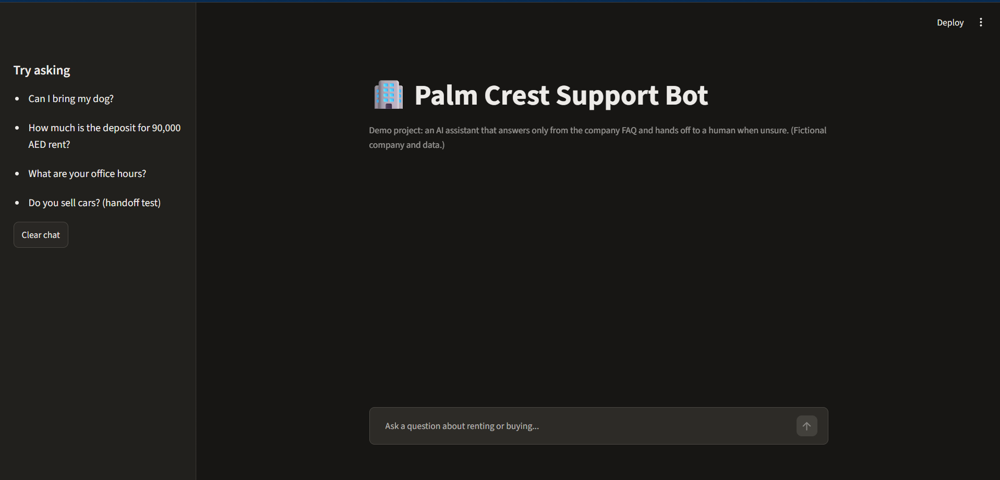
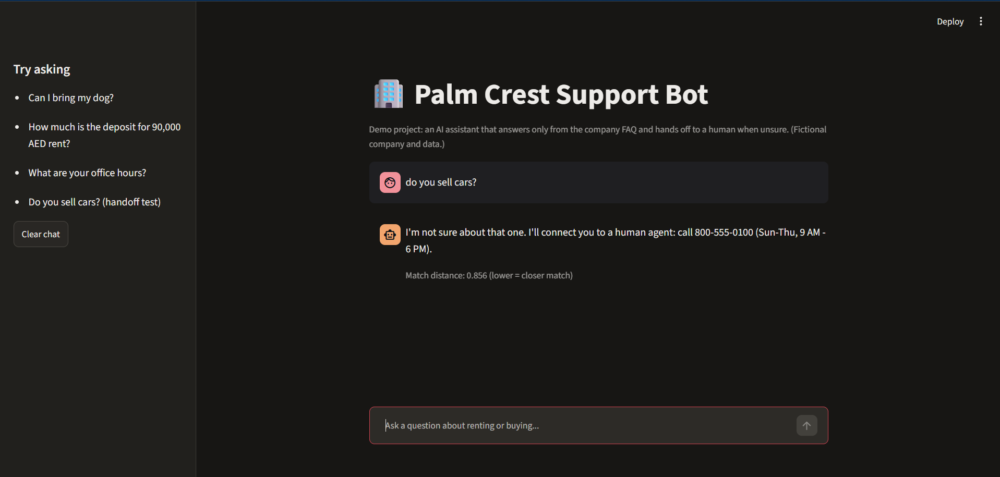
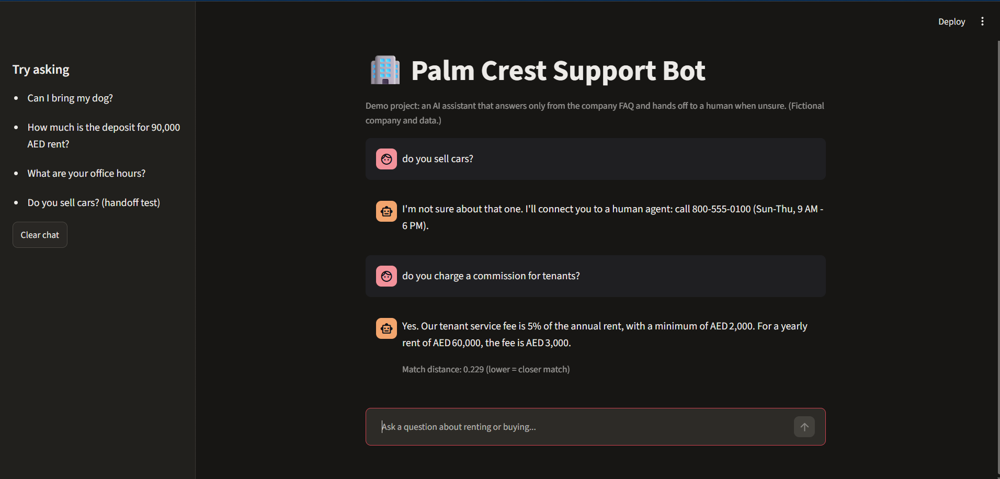
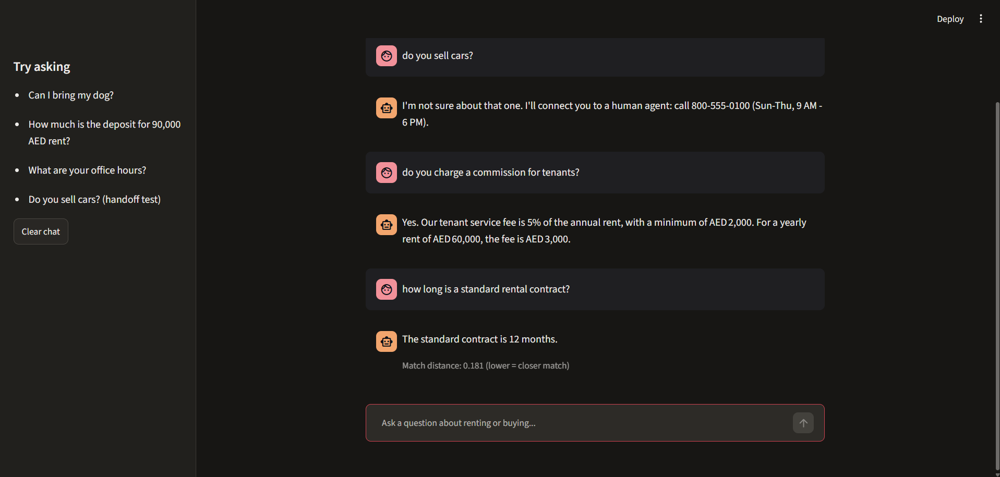

# Palm Crest Support Bot: AI Customer Support Agent (RAG)

An AI assistant that answers customer questions **only from a company's own FAQ** and hands the customer to a human when it is not sure.

> Demo project. The company (Palm Crest Properties), its policies and all numbers are fictional.

## The business problem
Support teams answer the same questions again and again (fees, deposits, opening hours, documents). Slow replies frustrate customers, and a chatbot that guesses can give wrong promises about money or rules.

## What this bot does
- Answers instantly using the company FAQ, with all conditions included (limits, fees, exceptions)
- Does simple calculations from the rules (for example, a 5% deposit on a 90,000 AED rent = 4,500 AED)
- Says "I'll connect you to a human" instead of guessing when the question is not covered

## How it works
1. **Chunking:** the FAQ is split into one question-and-answer pair per chunk.
2. **Embeddings:** each chunk is turned into numbers that capture its meaning (model: `all-MiniLM-L6-v2`).
3. **Vector search:** a question is converted the same way, and the closest chunks are found in a Chroma database.
4. **Safety check 1:** if even the best match is too far away (distance above 0.65), the bot hands off without calling the AI.
5. **Generation:** the AI receives the question plus only the retrieved chunks and must answer from them.
6. **Safety check 2:** if the AI says the answer is not in the context, the bot hands off to a human.

## Results
- Original test set: 29 questions. First run scored 72% (21/29). Seven of the 8
  failures were an over-strict answer checker, and one was a real retrieval gap
  (water-leak question). After fixing the checker and adding a paraphrased FAQ
  entry: 29/29.
- Unseen set: 10 new questions in messy everyday wording. First run: 8/10.
  Two false handoffs (cash payments, rent increase notice), caused by retrieval
  missing the right chunk. After adding question variants to the FAQ and
  re-testing: 10/10, with the original 29/29 still passing.
- Safety: the bot correctly handed off off-topic questions and questions the
  FAQ does not cover (for example, late payment penalties), instead of
  inventing answers.
- Note: scores after fixes are on questions I tuned against. A real deployment
  needs fresh test questions and ongoing FAQ updates from failed queries.

## What I improved along the way
- The handoff threshold was too strict (0.55), so valid questions like "can i bring my dog?" were refused. I tuned it to 0.65 using real distance values.
- Early answers were too short and left out conditions (for example, a cheque discount). I rewrote the prompt to require all relevant details.
- Diagnosed false handoffs by printing the retrieved chunks, found a retrieval gap, and added question variants to the FAQ.

## Tech stack
Python, sentence-transformers, ChromaDB, Streamlit, an OpenAI-compatible LLM API (Groq free tier; the provider can be swapped through settings).

## Run it yourself
```
python -m venv venv
venv\Scripts\activate
pip install -r requirements.txt
python step2_build_index.py
```
Set your own API key (never commit it):
```
$env:LLM_API_KEY="your_key_here"
$env:LLM_MODEL="model_name_from_your_provider"
streamlit run step5_app.py
```

## Files
- `company_faq.txt`: the fictional knowledge base
- `step2_build_index.py`: chunking, embeddings, vector database
- `step3_chat.py`: retrieval, safety checks and answer generation
- `step4_evaluate.py`: automatic test set and accuracy score
- `step5_app.py`: Streamlit chat page

## Limitations and next steps
- Uses a small, fictional FAQ; a real deployment needs the company's real documents and regular updates.
- Answers one question at a time without remembering earlier turns.
- Next: conversation memory, a feedback button, and logging of handed-off questions to improve the FAQ.

## Demo



